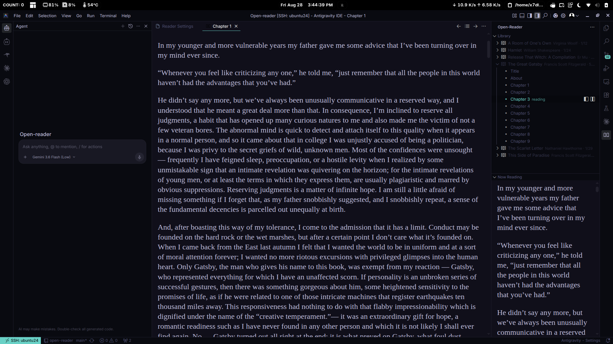
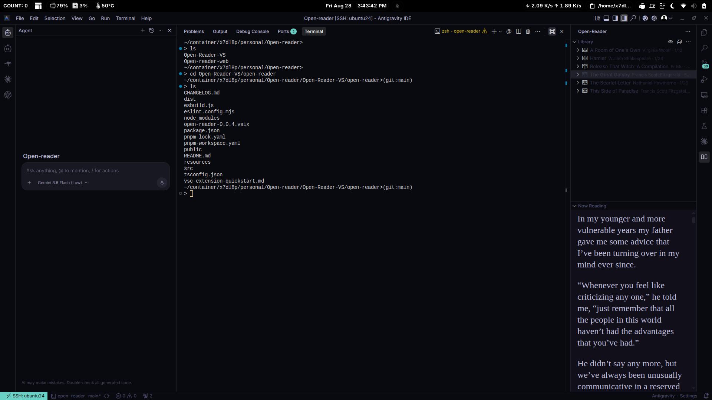
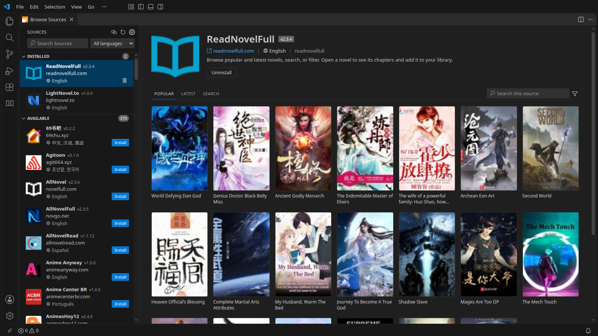
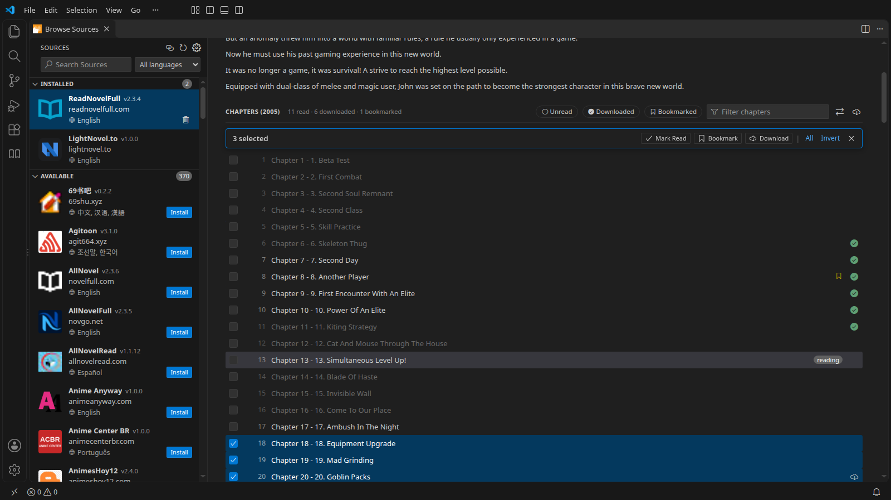
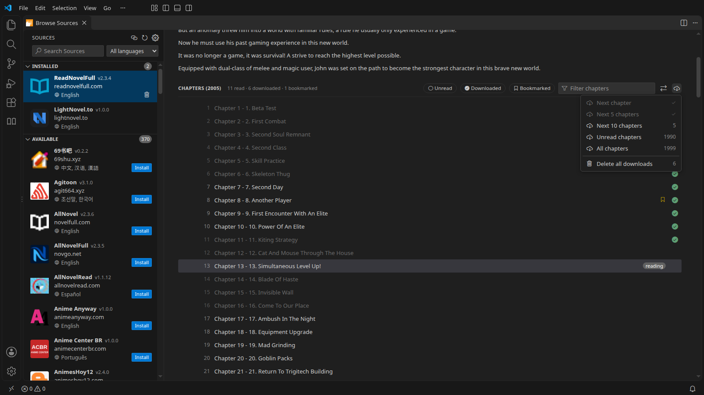
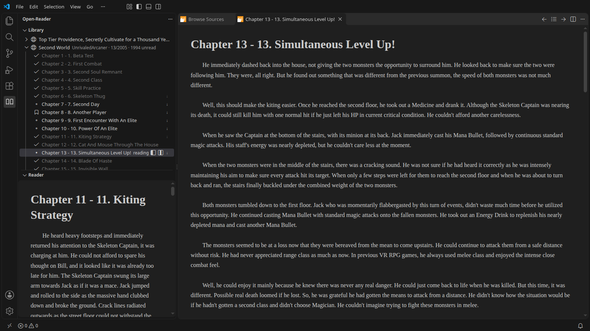
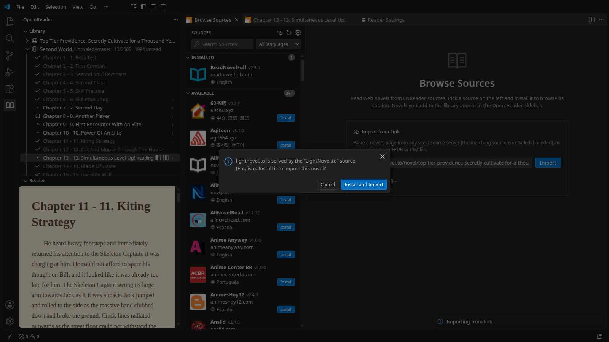
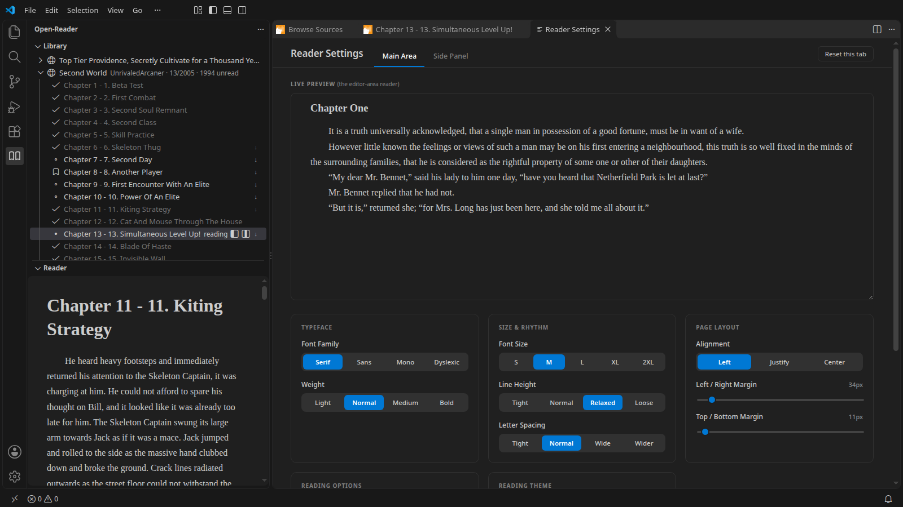
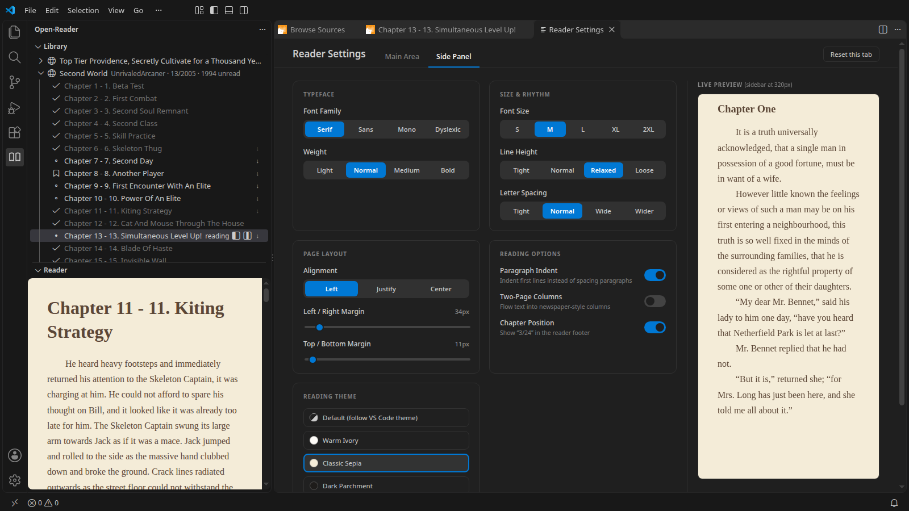
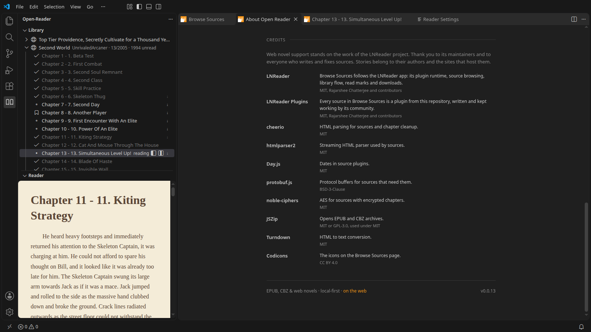

# Open Reader

**Read EPUB books, CBZ comics and web novels inside VS Code.** Read in the sidebar while you work, or full-width in the editor area. Your library, your typography and your reading progress stay on your machine.

Web novels come from **LNReader sources**: install a source, browse its catalog, add the novels you like to your library, and download chapters to read offline.

Also available on the web: **[open-reader-web.vercel.app](https://open-reader-web.vercel.app/)**

---

## Reading where you work

Books live in the sidebar next to your code. Open a chapter in the editor area for a full-width read, or keep it in the Reader panel below the library. Both are styled prose, never your editor's code font.



## The sidebar keeps your place

The Reader panel sits under the library, so a book stays open next to a terminal, a diff, or the Source Control view. Switch away and come back: **your scroll position is exactly where you left it**, per chapter.



---

## New: Browse Sources

Click the **extensions icon** in the Library title bar to open Browse Sources in the editor area. It is laid out like VS Code's own Extensions view: sources on the left with search and a language filter, the selected source on the right with Popular, Latest, Search and Filters.

Sources are [LNReader plugins](https://github.com/LNReader/lnreader-plugins), the same ones the LNReader app uses. Every source in the official repository is listed, and you can add more repositories in settings.



## Chapters, read marks and downloads

Open a novel to see its details and every chapter, then **Add to Library** and it appears in the sidebar like any other book.

- **Read chapters fade out.** A chapter is marked read when you reach its end or move on to the next one. **Continue** picks up at the first chapter you have not finished.
- **Select and act**, like the app's selection bar: hover a chapter for its checkbox, Shift-click for a range, then Mark Read, Mark Unread, Mark Previous Read, Bookmark, Download or Delete.
- **Filter** by Unread, Downloaded or Bookmarked, search chapter titles, or reverse the order.



**Download for offline reading**: the next chapter, the next 5 or 10, every unread chapter, or all of them. Progress shows on the page and in the status bar, and a click there cancels.



## Your progress in the Library

In the sidebar, read chapters are greyed out with a tick, bookmarks get their own icon, downloaded chapters carry a ↓ badge, and each novel shows how many chapters are still unread. Select several chapters (Ctrl or Shift click) and right-click to mark, bookmark or download them all at once.



## Import from a link

Click the **link icon** in the Library title bar, or use the box on the Browse Sources page, and paste:

- **a novel's page** from any site a source serves. Open Reader finds the matching source, offers to install it, and adds the novel to your library.
- **a direct link to an EPUB or CBZ file**. It is downloaded into your library.



## Two readers, two sets of settings

Reader Settings now has a tab for each reading surface, so the editor reader and the sidebar Reader can look different.

**Main Area** shows a full-width preview on top with the controls below it.



**Side Panel** puts the controls on the left and a preview on the right. Drag the divider to try the sidebar at different widths. Every change lands live in its own reader.



---

## Features

- **Library view.** Every `.epub` and `.cbz` in your library folders, plus the web novels you added, expandable to chapters, with per-book reading progress.
- **Browse Sources.** Install LNReader sources, browse popular and latest novels, search, filter, and add novels to your library.
- **Read marks, bookmarks and downloads.** Chapters you finish are marked read and fade out; bookmark chapters; download chapters to read offline. Works for local books too.
- **Import from link.** A novel's page on a supported site, or a direct EPUB or CBZ link.
- **File browsing.** The eye button in the view title swaps the book list for your workspace as it sits on disk. Books open in the reader, everything else opens as a normal editor tab.
- **Two reading surfaces.** The Reader panel in the sidebar, or a full-width editor tab, each with its own typography settings.
- **Resume where you left off.** Reading progress per book and scroll position per chapter, both remembered across restarts.
- **Reader Settings.** Font family, size and weight, line height, letter spacing, alignment, margins, paragraph indent, two-page columns, and reading themes (Warm Ivory, Classic Sepia, Dark Parchment, OLED Midnight, or your own colours).

## Install

Install from the [VS Code Marketplace](https://marketplace.visualstudio.com/items?itemName=x7dl8p.open-reader), from [Open VSX](https://open-vsx.org/extension/x7dl8p/open-reader) for Cursor, Windsurf, VSCodium and other forks, or grab the VSIX from [Releases](https://github.com/x7dl8p/open-reader-vs/releases/latest):

```
code --install-extension open-reader-0.2.0.vsix
```

Then open the **Open Reader** view in the activity bar. It scans your workspace for books. Use **Add Folder** in the view's `···` menu to add another folder, or **Browse Sources** to find web novels.

## Settings

All under `openReader.*`, editable from the Reader Settings page or `settings.json`:

| Setting | What it does |
| --- | --- |
| `libraryFolders` | Extra folders to scan for books, alongside the workspace. |
| `sourceRepositories` | LNReader plugin repositories (`plugins.min.json` URLs). Defaults to the official one. |
| `fontFamily`, `fontSize`, `fontWeight` | Editor reader: serif, sans, mono or dyslexic; five sizes; four weights. |
| `lineHeight`, `letterSpacing`, `textAlign` | Editor reader: rhythm and alignment. |
| `marginX`, `marginY` | Editor reader: padding around the text, in pixels. |
| `indent` | Indent first lines instead of spacing paragraphs apart. |
| `twoPageMode` | Newspaper-style columns instead of one flowing column. |
| `showChapterNumbers` | Show `3/24` in the reader footer. |
| `bgColor`, `textColor` | Custom reading theme. Empty follows your VS Code theme. |
| `sidePanel` | The same settings for the sidebar Reader, set from the Side Panel tab. |
| `restoreLastBook` | Reopen the last book and chapter when the window starts. |

## About sources

Sources are third-party scrapers written by the LNReader community. They run inside VS Code with the same trust model as the LNReader app: only add repositories you trust. Sites behind Cloudflare or other bot checks may not load, since VS Code has no built-in browser to pass them; the source shows a message when that happens. Stories belong to their authors and the sites that host them.

## Formats

EPUB, CBZ and web novels today. The format layer (`src/epub/formats.ts`) is a small registry, so new formats plug in without touching the rest of the extension.

**Known limitation:** tables and complex EPUB layouts are flattened to plain HTML.

## Credits

Web novel support is built on the work of the **[LNReader](https://github.com/LNReader/lnreader)** project (MIT, Rajarshee Chatterjee and contributors). The plugin runtime, source browsing, library flow, read marks and downloads follow the LNReader app, and every source comes from **[LNReader Plugins](https://github.com/LNReader/lnreader-plugins)** (MIT), kept working by its community. Thank you.

Also built with [cheerio](https://github.com/cheeriojs/cheerio), [htmlparser2](https://github.com/fb55/htmlparser2), [Day.js](https://github.com/iamkun/dayjs), [protobuf.js](https://github.com/protobufjs/protobuf.js), [noble-ciphers](https://github.com/paulmillr/noble-ciphers), [JSZip](https://github.com/Stuk/jszip), [Turndown](https://github.com/mixmark-io/turndown) and [Codicons](https://github.com/microsoft/vscode-codicons). The full list is on the About page.



## Releasing

Publishing needs `VSCE_PAT` (Marketplace) and `OVSX_PAT` (Open VSX), either exported or in the gitignored `.env`:

```
pnpm run release              # package, push, tag, GitHub release, both stores
pnpm run publish:marketplace  # VS Code Marketplace only
pnpm run publish:openvsx      # Open VSX only
```

## Links

- Developer: [github.com/x7dl8p](https://github.com/x7dl8p)
- Web reader: [open-reader-web.vercel.app](https://open-reader-web.vercel.app/)

## Release Notes

### 0.2.0

Web novels. Browse Sources installs LNReader sources and browses their novels; add novels to your library; read marks with faded read chapters, bookmarks, selection actions and chapter downloads, in the Browse page and the Library sidebar; import from a link; separate settings for the editor reader and the sidebar Reader; credits on the About page.

### 0.0.13

The last book reopens on start, and the chapter you are reading stays highlighted.

### 0.0.10

First Marketplace release. Web links now point at open-reader-web.vercel.app.

### 0.0.9

Library follows the open workspace; the eye button browses library files. About page with web and source links. New icon.

### 0.0.5

New icon, and a rewritten README with screenshots.

### 0.0.4

About page in the view's `···` menu.

### 0.0.3

Scroll position remembered per chapter; the eye button browses library files, with non-book files opening as normal editor tabs; shorter menu names; the Now Reading panel is now **Reader**.

### 0.0.2

The editor-area reader became a styled surface that follows the reader settings, instead of a plain text document. Chapter hover icons now name their destination.

### 0.0.1

Initial release.
